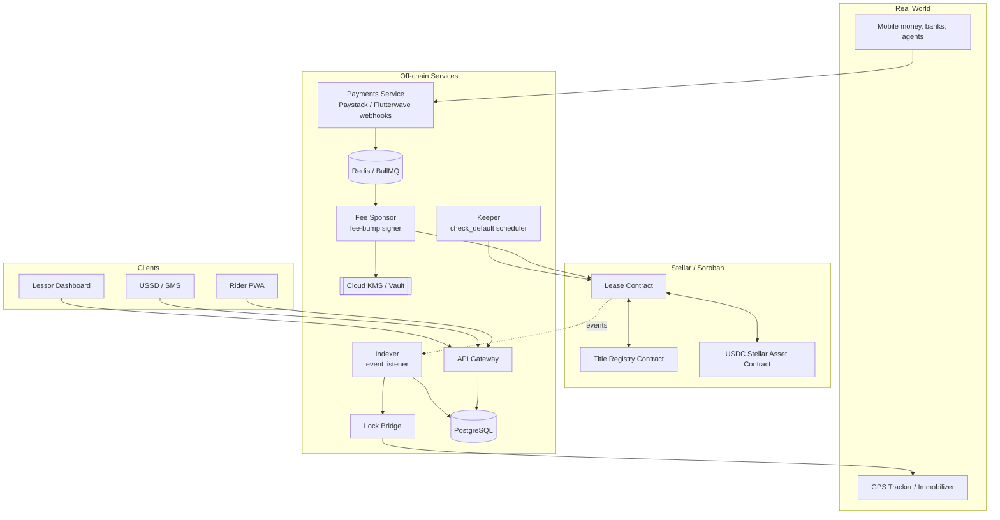
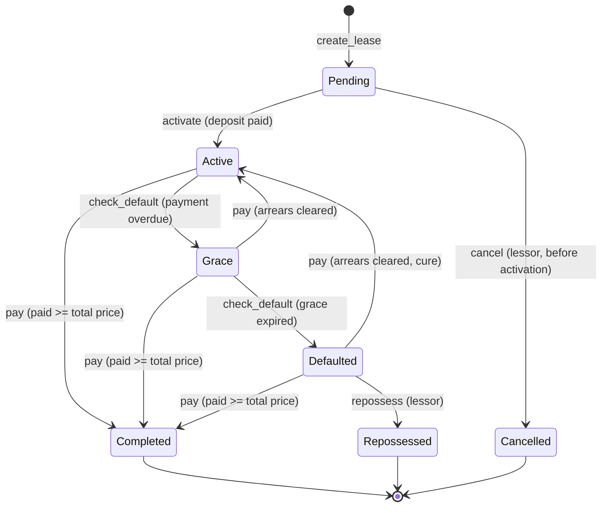

<div align="center">

# Mallaka

### Lease-to-own for the people who keep Africa moving.

**Daily and weekly payments that build real ownership of motorcycles, tricycles, and farm equipment, enforced by a Soroban smart contract on Stellar.**


</div>

> **Why "Mallaka"?** *Mallaka* is a Hausa word for ownership and possession. That is the whole product: every payment moves a rider one step closer to owning the machine that earns their living.

---

## Table of Contents

1. [Overview](#1-overview)
2. [The Problem](#2-the-problem)
3. [How It Works](#3-how-it-works)
4. [Key Features](#4-key-features)
5. [Architecture](#5-architecture)
6. [Lease Lifecycle and State Machine](#6-lease-lifecycle-and-state-machine)
7. [Smart Contract Specification](#7-smart-contract-specification)
8. [Payment Rules](#8-payment-rules)
9. [Off-Chain Services](#9-off-chain-services)
10. [Client Applications](#10-client-applications)
11. [Lock and Immobilizer Integration](#11-lock-and-immobilizer-integration)
12. [Payments, Wallets, and On/Off-Ramp](#12-payments-wallets-and-onoff-ramp)
13. [Tech Stack](#13-tech-stack)
14. [Repository Structure](#14-repository-structure)
15. [Getting Started](#15-getting-started)
16. [Configuration Reference](#16-configuration-reference)
17. [Testing Strategy](#17-testing-strategy)
18. [Deployment](#18-deployment)
19. [Security Considerations](#19-security-considerations)
20. [Legal, Compliance, and Ethics](#20-legal-compliance-and-ethics)
21. [Roadmap](#21-roadmap)
22. [Open Design Questions](#22-open-design-questions)
23. [Contributing](#23-contributing)
24. [FAQ](#24-faq)
25. [License](#25-license)

---

## 1. Overview

Mallaka is an open-source lease-to-own platform for **motorcycle taxi (okada) riders, tricycle (keke) drivers, and smallholder farmers** who need a vehicle or machine but cannot get traditional asset finance.

A lessor (a dealer, cooperative, fleet owner, or microfinance institution) lists an asset and sets the terms. A rider takes the lease and pays a small amount daily or weekly. The **Soroban smart contract** is the single source of truth for:

- how much has been paid and how much remains,
- when the next payment is due,
- whether the rider is current, in a grace period, or in default,
- and who holds the **title** to the asset.

When the final payment lands, the contract **transfers title to the rider automatically**. No paperwork, no chasing, no ambiguity about who owns what.

Real-world enforcement (immobilizing or locking the asset after default) happens **off-chain**, driven by contract events. The chain decides, and the device obeys.

### Design principles

| Principle | What it means in practice |
|---|---|
| **The contract is the source of truth** | Lock bridges, apps, and dashboards read state from the chain. They never invent state. |
| **Riders never touch crypto** | No seed phrases, no XLM, no gas. Riders pay in naira through channels they already use. |
| **Small payments must be cheap** | Stellar's low fees make daily installments economical. |
| **Transparent and auditable** | Every payment, grace period, and default is an on-chain event either party can verify. |
| **Fair by construction** | Capped fees, explicit grace periods, and reversible locks are built into the rules, not left to goodwill. |
| **Enforcement stays off-chain** | Smart contracts cannot repossess a motorcycle. We bridge to the real world carefully and reversibly. |

---

## 2. The Problem

Millions of people earn a living from a single vehicle or machine, but most do not own it.

- **Daily-rental ("hire purchase") arrangements are opaque.** Riders pay for years and often cannot prove how much they have paid. Disputes over balances are common, and ownership may never transfer.
- **Banks do not serve this segment.** There is no formal credit history, no collateral beyond the asset itself, and income is daily and irregular.
- **Lessors carry real risk.** Collecting small payments in cash is expensive, defaults are hard to manage, and assets can disappear.
- **Farm equipment is seasonal.** Smallholders earn at harvest, so fixed weekly payments do not match their cash flow.

Mallaka makes the arrangement **verifiable for the rider** (a tamper-proof payment record and guaranteed title transfer) and **enforceable for the lessor** (automatic default detection and a reversible lock).

---

## 3. How It Works

```
 LESSOR                       MALLAKA                        RIDER
   |                             |                             |
   | 1. List asset, set terms    |                             |
   |---------------------------->|                             |
   |   (price, deposit,          |  Title escrowed in contract |
   |    installment, grace)      |                             |
   |                             |   2. Review terms, sign     |
   |                             |<----------------------------|
   |                             |      pay deposit            |
   |                             |                             |
   |    Asset handed over        |   3. Lease becomes ACTIVE   |
   |<------------------------------------------------------->|
   |                             |                             |
   |                             |  4. Pay daily/weekly via    |
   |   Funds arrive directly     |     mobile money / transfer |
   |<----------------------------|<----------------------------|
   |                             |   Balance and due date      |
   |                             |   update on-chain           |
   |                             |                             |
   |                             |  5a. Missed payment:        |
   |                             |      GRACE -> DEFAULTED     |
   |   Lock bridge locks asset   |      (lock engages)         |
   |<----------------------------|                             |
   |                             |  5b. Rider catches up:      |
   |   Lock releases instantly   |      back to ACTIVE         |
   |                             |                             |
   |                             |  6. Final payment lands     |
   |                             |     TITLE -> RIDER          |
   |                             |     Lease COMPLETED         |
```

---

## 4. Key Features

### For riders and farmers
- Pay in **Nigerian naira** via bank transfer, card, USSD, or mobile money. No wallet needed.
- See **balance remaining, next due date, and payment history** at any time, even offline.
- **Grace periods** protect against a slow day or a bad week.
- **Prepayments credit forward**, so paying extra during a good week covers a bad one later.
- **Guaranteed title transfer** on the final payment, enforced by code.
- Works on **low-end Android** (PWA) and **feature phones** (USSD/SMS).

### For lessors
- Funds go **directly to the lessor's account**. The contract never pools customer money.
- **Automated default detection** by a permissionless keeper.
- **Reversible lock** (manual first, GPS/immobilizer later) that releases the moment payment lands.
- Dashboard with portfolio view, collections, delinquency, and exports.
- Fee-sponsored transactions, so the lessor handles network costs and riders never see them.

### For the ecosystem
- **Open source** contracts and services.
- **Auditable** on-chain records and open event schema.
- Extensible to other asset classes (solar kits, refrigeration, tools, phones).

---

## 5. Architecture



### Responsibility split

| Concern | Lives on-chain | Lives off-chain |
|---|---|---|
| Lease terms and balance | Yes | Cached in Postgres for fast reads |
| Payment recording | Yes | Receipts, naira reference, FX rate |
| Default status | Yes (via `check_default`) | Triggered by the keeper |
| Title ownership | Yes | Physical documents and registration |
| Lock and unlock | Event emitted | Command sent to the device |
| KYC and identity | No | Stored securely, referenced by hash only |
| Naira on/off-ramp | No | Payment providers and anchors |

> **Privacy note:** Personal data (names, phone numbers, ID numbers, addresses) is **never** written to the chain. The chain stores opaque IDs and hashes only.

---

## 6. Lease Lifecycle and State Machine



| State | Meaning | Lock state | Title |
|---|---|---|---|
| `Pending` | Terms set, awaiting rider signature and deposit | Unlocked / not issued | Escrowed |
| `Active` | Rider is current on payments | **Unlocked** | Escrowed |
| `Grace` | Payment is overdue but within the grace window | **Unlocked** | Escrowed |
| `Defaulted` | Grace window expired | **Locked** (subject to safety rules) | Escrowed |
| `Completed` | Fully paid | Permanently unlocked | **Transferred to rider** |
| `Repossessed` | Lessor reclaimed the asset after default | n/a | Released back to lessor |
| `Cancelled` | Never activated | n/a | Released back to lessor |

---

## 7. Smart Contract Specification

> **Status:** Specification. Names and signatures may change before the first testnet release.

### 7.1 Contracts

| Contract | Purpose |
|---|---|
| `lease` | Core lease logic: terms, payments, state transitions, title release. |
| `title-registry` | Minimal asset title registry (or NFT interface) that the lease contract holds in escrow and transfers on completion. |

Payments use the **Stellar Asset Contract (SAC)** for USDC via the standard Soroban token interface. No custom token is deployed.

### 7.2 Data types

```rust
#[contracttype]
#[derive(Clone, Copy, PartialEq, Eq)]
pub enum Status {
    Pending,
    Active,
    Grace,
    Defaulted,
    Completed,
    Repossessed,
    Cancelled,
}

#[contracttype]
#[derive(Clone)]
pub struct Lease {
    pub id: u64,
    pub lessor: Address,
    pub lessee: Address,
    pub asset_id: BytesN<32>,       // hash of off-chain asset record (VIN, serial, etc.)
    pub title_contract: Address,    // registry holding the title in escrow
    pub token: Address,             // payment token (USDC SAC)

    pub total_price: i128,          // total amount to own, in token base units
    pub deposit: i128,
    pub installment: i128,
    pub interval: u64,              // seconds between installments
    pub grace: u64,                 // seconds after due date before default

    pub paid: i128,                 // cumulative paid, excluding deposit
    pub start_ts: u64,              // schedule start (set on activation)
    pub status: Status,
}
```

### 7.3 Functions

| Function | Caller | Description |
|---|---|---|
| `create_lease(terms) -> u64` | Lessor | Registers terms and moves the title into escrow. Status `Pending`. |
| `activate(lease_id)` | Lessee | Lessee signs and pays the deposit to the lessor. Starts the schedule. Status `Active`. |
| `pay(lease_id, payer, amount)` | Lessee **or any payer** | Transfers `amount` from `payer` to the lessor, updates `paid`, recomputes status, completes the lease and transfers title when `paid >= total_price - deposit`. If arrears are cleared from `Grace` or `Defaulted`, status returns to `Active`. |
| `check_default(lease_id)` | **Anyone** | Permissionless. Moves `Active` to `Grace` or `Defaulted` based on ledger time. Emits the matching event. |
| `repossess(lease_id)` | Lessor | Allowed only from `Defaulted` and only after the configured minimum default period. Releases title to the lessor. |
| `cancel(lease_id)` | Lessor | Allowed only while `Pending`. Releases title. |
| `get_lease(lease_id) -> Lease` | Anyone | Read-only. |
| `get_status(lease_id) -> LeaseView` | Anyone | Read-only view with balance remaining, next due timestamp, arrears, and current status. |
| `extend_ttl(lease_id)` | Anyone | Bumps storage TTL for the lease entry so it never expires mid-lease. |

> `pay` accepts a separate `payer` address so that the backend, an agent, or a family member can pay on a rider's behalf without the rider signing each time.

### 7.4 Events

| Event | Topics | Data | Consumed by |
|---|---|---|---|
| `lease_created` | `lease_id`, `lessor`, `lessee` | terms hash | Indexer |
| `activated` | `lease_id` | start_ts, deposit | Indexer, Lock bridge (issue device) |
| `payment` | `lease_id`, `payer` | amount, paid_total, next_due | Indexer, Notifications |
| `grace_entered` | `lease_id` | due_ts, grace_ends | Notifications (reminder) |
| `defaulted` | `lease_id` | arrears | **Lock bridge (lock)** |
| `cured` | `lease_id` | paid_total | **Lock bridge (unlock)** |
| `completed` | `lease_id`, `lessee` | final_paid | Lock bridge (permanent unlock), Indexer |
| `repossessed` | `lease_id` | ts | Lock bridge, Indexer |
| `cancelled` | `lease_id` | ts | Indexer |

### 7.5 Errors

```rust
#[contracterror]
#[derive(Clone, Copy, Debug, Eq, PartialEq)]
#[repr(u32)]
pub enum Error {
    NotFound = 1,
    Unauthorized = 2,
    InvalidTerms = 3,
    InvalidState = 4,
    InvalidAmount = 5,
    AlreadyActive = 6,
    NotDefaulted = 7,
    RepossessionTooEarly = 8,
    Overpayment = 9,
    MathOverflow = 10,
}
```

### 7.6 Storage and TTL

- **Persistent storage** holds each `Lease` under its `lease_id`. Persistent entries expire unless their TTL is extended, so every state-changing call bumps TTL and the keeper runs `extend_ttl` on a schedule.
- **Instance storage** holds contract-level config: admin, protocol version, and the next lease ID.
- Related fields that change together are stored in a **single entry** to minimize reads and writes.

### 7.7 Authorization model

- `create_lease`, `repossess`, `cancel`: `lessor.require_auth()`
- `activate`: `lessee.require_auth()`
- `pay`: `payer.require_auth()`
- `check_default`, `extend_ttl`, and all getters: no auth required (safe because they only advance state in the direction the rules already dictate)

---

## 8. Payment Rules

These rules are the heart of the product, so they are stated explicitly and enforced in the contract.

### 8.1 How the schedule works

Installment `k` (for `k = 1, 2, 3, ...`) is due at:

```
due(k) = start_ts + k * interval
```

The number of **fully covered installments** is:

```
covered = floor(paid / installment)
```

The **next installment that must be paid** is `covered + 1`, due at `due(covered + 1)`.

### 8.2 Status derivation

Let `next_due = due(covered + 1)` and `now` be the ledger timestamp.

| Condition | Status |
|---|---|
| `now <= next_due` | `Active` |
| `next_due < now <= next_due + grace` | `Grace` |
| `now > next_due + grace` | `Defaulted` |
| `paid >= total_price - deposit` | `Completed` (title transfers) |

### 8.3 Rules that follow

1. **Partial payments accumulate but do not count as on time** until they add up to a full installment.
2. **Prepayments credit forward.** Paying two installments in one day advances `next_due` by two intervals.
3. **Catch-up payments cure arrears.** Any payment that raises `covered` far enough to make `now <= next_due + grace` returns the lease to `Active` (or `Grace`, then `Active`) and emits `cured`.
4. **No overpayment past the price.** A payment is capped at the remaining balance. Excess is rejected, not silently kept.
5. **Rounding is explicit.** All amounts are integers in token base units. The final installment absorbs any remainder.
6. **Time source is the ledger close time**, not a client-supplied value.

### 8.4 Late fees

**Off by default in the MVP.** If enabled later, fees must be:

- capped (a fixed maximum per lease),
- shown to the rider before they sign,
- and never compounding.

### 8.5 Seasonal and milestone schedules (planned)

Farm equipment needs payments that follow harvest income. A future `Schedule::Milestones` mode will replace fixed intervals with a list of dated amounts:

```rust
pub struct Milestone { pub due_offset: u64, pub amount: i128 }
```

The contract will compare `paid` against the **cumulative amount due** at `now` instead of `covered * installment`. Fixed-interval leases will remain the simple default.

---

## 9. Off-Chain Services

All services are TypeScript on Node.js and live under `services/`.

| Service | Responsibility |
|---|---|
| **`api`** | REST API for apps: auth, lease views, payment initiation, receipts. Reads from Postgres, falls back to chain. |
| **`payments`** | Receives Paystack/Flutterwave webhooks, verifies signatures, credits the rider's balance, enqueues an on-chain `pay`. Idempotent by payment reference. |
| **`keeper`** | Scheduled job that calls `check_default` for leases near or past due, and `extend_ttl` for leases nearing expiry. Retries with backoff. |
| **`indexer`** | Reads Soroban RPC events, **persists them to Postgres** (RPC retains events for a limited window only), and fans out to the lock bridge and notifications. |
| **`lock-bridge`** | Subscribes to `defaulted`, `cured`, `completed`, `repossessed` events and sends commands to the device vendor API or MQTT broker. |
| **`sponsor`** | Signs **fee-bump transactions** from the sponsor account so riders never need XLM. Manages sequence numbers and low-balance alerts. |
| **`notifier`** | SMS, WhatsApp, and push reminders before due dates, in English, Hausa, Yoruba, Igbo, and Pidgin. |

### Idempotency and reliability

- Every inbound payment webhook is keyed by the provider's unique reference. Replays do nothing.
- Every on-chain submission is **simulated first**, then submitted with a retry policy and a transaction-status poller.
- The indexer stores a **ledger cursor** so it can resume after downtime without gaps.

### Indicative REST API

```
POST   /v1/auth/otp/request
POST   /v1/auth/otp/verify

GET    /v1/leases                       # lessor: portfolio; rider: own leases
POST   /v1/leases                       # lessor: create lease
GET    /v1/leases/:id                   # terms + live status
POST   /v1/leases/:id/activate          # rider signs and pays deposit
GET    /v1/leases/:id/payments          # payment history
POST   /v1/leases/:id/payments/initiate # start a naira payment, returns provider checkout
GET    /v1/leases/:id/receipt/:paymentId

POST   /v1/webhooks/paystack
POST   /v1/webhooks/flutterwave

POST   /v1/admin/leases/:id/lock        # manual lock (Phase 1)
POST   /v1/admin/leases/:id/unlock
GET    /v1/admin/audit-log
```

### Indicative database tables

| Table | Purpose |
|---|---|
| `users` | Riders and lessor staff (contact info stored encrypted) |
| `lessors` | Organizations, payout settings |
| `assets` | VIN or serial, type, photos, device ID, hash anchored on-chain |
| `leases` | Cached lease state mirroring the chain |
| `payments` | Naira amount, token amount, FX rate, provider reference, tx hash |
| `chain_events` | Raw persisted contract events with ledger cursor |
| `lock_commands` | Every lock/unlock command, who or what triggered it, and the result |
| `audit_log` | Append-only record of admin actions |

---

## 10. Client Applications

### Rider PWA (`apps/rider-pwa`)
- Installable, offline-tolerant, and light on data.
- Home screen: **balance remaining, next due date, progress to ownership**.
- Pay button with saved methods, plus payment history and downloadable receipts.
- Multilingual UI.

### USSD and SMS (`apps/ussd`)
- Short code flow for feature phones: check balance, next due date, pay, last 5 payments.
- Built on Africa's Talking.
- SMS reminders and confirmations after every payment.

### Lessor Dashboard (`apps/lessor-dashboard`)
- Portfolio overview: active, grace, defaulted, completed.
- Collections and delinquency reports, CSV export.
- Create leases, upload asset records, manage manual locks.
- Audit log and device status.

---

## 11. Lock and Immobilizer Integration

The lock is a **consequence** of contract state, never a source of it.

```
Contract event (defaulted)
        |
        v
   Indexer persists event
        |
        v
   Lock Bridge validates:
     - lease is still Defaulted on-chain (re-read, do not trust the event alone)
     - safety rules pass (see below)
        |
        v
   Command -> device vendor API / MQTT
        |
        v
   Result logged in lock_commands
```

### Phases

| Phase | Mechanism | Purpose |
|---|---|---|
| **1** | Manual lock toggled by the lessor from the dashboard | Validate the business model before buying hardware |
| **2** | Off-the-shelf **GPS tracker with immobilizer relay** via vendor API | Automated, low-cost enforcement |
| **3** | Custom ESP32-based device (only if vendor options do not fit) | Specialized needs such as farm machinery |

### Safety rules (mandatory)

- **Never immobilize a moving vehicle.** Engage only when the vehicle is stationary and the engine is off, or at the next stop.
- **Notify first.** The rider receives SMS and app notifications at `Grace` entry and before any lock.
- **Release instantly.** On `cured` or `completed`, the unlock command is sent immediately and retried until acknowledged.
- **Fail open.** If the bridge cannot confirm contract state, it does not lock.
- **Every command is logged** with a trigger, timestamp, and result.
- **Local law applies.** Remote immobilization and repossession rules vary by jurisdiction. See [Legal, Compliance, and Ethics](#20-legal-compliance-and-ethics).

> The IoT device **never holds a wallet or private key**. It only receives authenticated commands from the bridge.

---

## 12. Payments, Wallets, and On/Off-Ramp

### The rider's experience

1. Rider taps **Pay** (or dials a USSD code).
2. Rider pays naira via card, bank transfer, or mobile money.
3. The provider webhook confirms payment.
4. The backend converts to the settlement token and calls `pay` on the lease contract.
5. Rider sees the updated balance in seconds.

### Custody model

| Option | Description | Trade-off |
|---|---|---|
| **Custodial (MVP default)** | Backend holds rider keys in KMS, or acts as authorized payer | Simplest for riders; places regulatory and security responsibility on the operator |
| **Passkey smart accounts** | Rider signs with device biometrics | More decentralized; more engineering and onboarding effort |

The MVP uses **custodial payer authorization** with a clear migration path to passkeys.

### Fee sponsorship

Riders hold no XLM. The `sponsor` service wraps transactions in **fee-bump transactions** paid by a sponsor account. Monitoring alerts when the sponsor balance falls below a threshold.

### Fiat rails

| Route | Use |
|---|---|
| **Paystack / Flutterwave** | Primary collection channel for NGN (cards, transfer, USSD, mobile money) |
| **Stellar anchors (SEP-24 / SEP-6)** | Optional for lessors who want to settle in or out of stablecoins |
| **Agent network** | Cash payments through local agents who top up a rider's balance |

> Settlement-token liquidity and anchor availability for NGN should be verified before launch.

---

## 13. Tech Stack

| Layer | Technology |
|---|---|
| **Smart contracts** | Rust, `soroban-sdk`, Stellar CLI, `cargo test` with `testutils` |
| **Token** | Stellar Asset Contract wrapping USDC |
| **Backend** | TypeScript, Node.js, Fastify (or NestJS), `@stellar/stellar-sdk` |
| **Chain access** | Soroban RPC |
| **Database** | PostgreSQL |
| **Queues and scheduling** | Redis, BullMQ |
| **Secrets and keys** | Cloud KMS or HashiCorp Vault |
| **Rider app** | Next.js (PWA), React, Tailwind CSS |
| **Feature phones** | Africa's Talking (USSD and SMS) |
| **Payments** | Paystack and/or Flutterwave |
| **Device messaging** | MQTT (EMQX or Mosquitto) or vendor HTTP API |
| **Infrastructure** | Docker, GitHub Actions, AWS/GCP/Fly.io |
| **Observability** | Prometheus, Grafana, Sentry |
| **Monorepo tooling** | Cargo workspace plus pnpm workspaces and Turborepo |

---

## 14. Repository Structure

```
mallaka/
├── contracts/                      # Cargo workspace
│   ├── lease/
│   │   ├── src/
│   │   │   ├── lib.rs              # contract entrypoints
│   │   │   ├── types.rs            # Lease, Status, errors
│   │   │   ├── schedule.rs         # due-date and status derivation
│   │   │   ├── storage.rs          # keys, TTL helpers
│   │   │   ├── events.rs           # event definitions
│   │   │   └── test.rs             # unit and scenario tests
│   │   └── Cargo.toml
│   ├── title-registry/
│   └── Cargo.toml
│
├── services/
│   ├── api/                        # REST API
│   ├── payments/                   # provider webhooks and reconciliation
│   ├── keeper/                     # check_default and TTL bumps
│   ├── indexer/                    # event ingestion
│   ├── lock-bridge/                # device command bridge
│   ├── sponsor/                    # fee-bump signing
│   └── notifier/                   # SMS / WhatsApp / push
│
├── apps/
│   ├── rider-pwa/
│   ├── lessor-dashboard/
│   └── ussd/
│
├── packages/
│   ├── contract-bindings/          # generated TypeScript bindings
│   ├── shared/                     # shared types, utils, config schemas
│   └── eslint-config/
│
├── infra/
│   ├── docker/                     # Dockerfiles and compose files
│   └── terraform/                  # cloud infrastructure (optional)
│
├── scripts/                        # deploy, seed, local-dev helpers
├── docs/
│   ├── architecture.md
│   ├── contract-spec.md
│   ├── payment-rules.md
│   ├── lock-safety.md
│   └── runbooks/
│
├── .github/workflows/              # CI
├── .env.example
├── package.json
├── pnpm-workspace.yaml
├── turbo.json
├── LICENSE
└── README.md
```

---

## 15. Getting Started

### 15.1 Prerequisites

| Tool | Version | Notes |
|---|---|---|
| Rust | stable (with `wasm32v1-none` or `wasm32-unknown-unknown` target) | Check the current Soroban docs for the required target |
| Stellar CLI | latest | `cargo install --locked stellar-cli` |
| Node.js | 20 LTS or newer | |
| pnpm | 9+ | `npm i -g pnpm` |
| Docker and Docker Compose | recent | For Postgres and Redis |
| A Stellar testnet account | | Funded via the CLI (see below) |

### 15.2 Clone and install

```bash
git clone https://github.com/<your-org>/mallaka.git
cd mallaka

# JavaScript / TypeScript workspace
pnpm install

# Rust toolchain target for contracts
rustup target add wasm32v1-none   # or wasm32-unknown-unknown, per current Soroban docs
```

### 15.3 Build and test the contracts

```bash
cd contracts

# Run all unit and scenario tests
cargo test

# Build optimized WASM
stellar contract build
```

### 15.4 Create a testnet identity

```bash
stellar keys generate lessor --network testnet --fund
stellar keys generate rider  --network testnet --fund
stellar keys generate keeper --network testnet --fund
stellar keys generate sponsor --network testnet --fund
```

### 15.5 Deploy to testnet

```bash
# Deploy the title registry
stellar contract deploy \
  --wasm target/wasm32v1-none/release/title_registry.wasm \
  --source lessor \
  --network testnet \
  --alias title_registry

# Deploy the lease contract
stellar contract deploy \
  --wasm target/wasm32v1-none/release/lease.wasm \
  --source lessor \
  --network testnet \
  --alias lease
```

> The exact output path depends on your Rust target. Adjust accordingly.

### 15.6 Generate TypeScript bindings

```bash
stellar contract bindings typescript \
  --network testnet \
  --contract-id <LEASE_CONTRACT_ID> \
  --output-dir packages/contract-bindings/lease \
  --overwrite
```

### 15.7 Start local infrastructure

```bash
docker compose -f infra/docker/docker-compose.dev.yml up -d   # Postgres + Redis
cp .env.example .env                                          # then fill in values
pnpm db:migrate
```

### 15.8 Run the services and apps

```bash
pnpm dev                 # runs api, keeper, indexer, payments, lock-bridge, rider-pwa
# or individually:
pnpm --filter @mallaka/api dev
pnpm --filter @mallaka/keeper dev
pnpm --filter @mallaka/rider-pwa dev
```

### 15.9 Try a lease end to end (CLI)

```bash
# 1. Lessor creates a lease (illustrative arguments)
stellar contract invoke --id lease --source lessor --network testnet -- \
  create_lease --terms '{ ... }'

# 2. Rider activates and pays the deposit
stellar contract invoke --id lease --source rider --network testnet -- \
  activate --lease_id 1

# 3. Make a payment
stellar contract invoke --id lease --source rider --network testnet -- \
  pay --lease_id 1 --payer <RIDER_ADDRESS> --amount 5000000

# 4. Anyone can check for default
stellar contract invoke --id lease --source keeper --network testnet -- \
  check_default --lease_id 1

# 5. Read status
stellar contract invoke --id lease --network testnet -- \
  get_status --lease_id 1
```

---

## 16. Configuration Reference

Copy `.env.example` to `.env` and fill in the values.

| Variable | Service | Description |
|---|---|---|
| `STELLAR_NETWORK` | all | `testnet` or `mainnet` |
| `SOROBAN_RPC_URL` | api, keeper, indexer, sponsor | Soroban RPC endpoint |
| `HORIZON_URL` | sponsor | Horizon endpoint for account data (if used) |
| `LEASE_CONTRACT_ID` | all | Deployed lease contract ID |
| `TITLE_REGISTRY_CONTRACT_ID` | api, lock-bridge | Deployed registry contract ID |
| `PAYMENT_TOKEN_CONTRACT_ID` | api, payments | USDC SAC contract ID |
| `DATABASE_URL` | all | PostgreSQL connection string |
| `REDIS_URL` | api, keeper, payments, sponsor | Redis connection string |
| `KMS_KEY_ID` | sponsor, keeper, payments | Reference to the signing key in KMS/Vault |
| `SPONSOR_PUBLIC_KEY` | sponsor | Fee-sponsor account address |
| `SPONSOR_MIN_BALANCE` | sponsor | Alert threshold for low balance |
| `PAYSTACK_SECRET_KEY` | payments | Webhook signature verification |
| `FLUTTERWAVE_SECRET_HASH` | payments | Webhook verification |
| `AFRICASTALKING_API_KEY` | ussd, notifier | USSD and SMS provider |
| `AFRICASTALKING_USERNAME` | ussd, notifier | |
| `LOCK_VENDOR_API_URL` | lock-bridge | GPS/immobilizer vendor API |
| `LOCK_VENDOR_API_KEY` | lock-bridge | |
| `MQTT_URL` | lock-bridge | Optional MQTT broker |
| `KEEPER_INTERVAL_SECONDS` | keeper | How often to scan leases |
| `JWT_SECRET` | api | Session signing |
| `MANUAL_LOCK_APPROVAL_THRESHOLD` | api | **Added (ADR-012).** Remaining balance (token base units) above which a manual lock needs a second approver. Default `0`. |
| `SENTRY_DSN` | all | Error reporting |

> **Never commit real secrets.** Production keys belong in KMS or Vault, not in environment files.

---

## 17. Testing Strategy

### Contract tests (`cargo test`)

Using `soroban-sdk` testutils with mocked ledger time and mocked auth.

| Scenario | Expectation |
|---|---|
| Happy path: create, activate, pay to completion | Title transfers on final payment |
| On-time payments across many intervals | Stays `Active` |
| Missed payment inside grace | `Active` to `Grace` to `Active` after catch-up |
| Missed payment beyond grace | `Defaulted`, `defaulted` event emitted |
| Cure after default | Returns to `Active`, `cured` event emitted |
| Partial payments | Accumulate, do not count as on time until full |
| Prepayment | `next_due` advances by multiple intervals |
| Overpayment | Rejected with `Overpayment` |
| Third-party payer | Funds reach the lessor, balance updates |
| Unauthorized `repossess`, `cancel`, `activate` | Rejected |
| `repossess` before minimum default period | Rejected with `RepossessionTooEarly` |
| `check_default` called by anyone, repeatedly | Idempotent, no state corruption |
| TTL extension | Entry survives past default TTL |
| Arithmetic edge cases | No overflow, final installment absorbs remainder |

Property-based tests (for example with `proptest`) should assert invariants such as `paid <= total_price - deposit` and that status transitions only follow the diagram in section 6.

### Service tests
- Unit tests for webhook signature verification and idempotency.
- Integration tests against a local Soroban sandbox or testnet.
- Contract tests for the lock bridge: events in, expected device commands out, including **fail-open** behavior.

### End-to-end
- A scripted scenario that runs a full lease on testnet with simulated mobile-money webhooks and a mock lock device.

### CI
GitHub Actions runs on every push and pull request:

```
cargo fmt --check
cargo clippy -- -D warnings
cargo test
stellar contract build
pnpm lint
pnpm typecheck
pnpm test
```

---

## 18. Deployment

### Environments

| Environment | Network | Purpose |
|---|---|---|
| `local` | Local sandbox or testnet | Development |
| `staging` | Stellar Testnet | Integration and pilot rehearsal |
| `production` | Stellar Mainnet | Live leases |

### Contract release checklist

- [ ] All tests pass, including property-based tests
- [ ] **Independent security audit** completed and findings resolved
- [ ] Contract WASM hash recorded and published
- [ ] Upgrade and admin-key policy documented (multisig for admin, or immutable)
- [ ] Testnet pilot run with real riders using test funds
- [ ] Runbooks reviewed: keeper failure, sponsor out of funds, RPC outage, indexer gap

### Operational runbooks (`docs/runbooks/`)
- Keeper stopped or lagging
- Sponsor account low on balance
- RPC provider outage and failover
- Indexer gap recovery from ledger cursor
- Lock bridge stuck or device unreachable
- Disputed payment reconciliation

---

## 19. Security Considerations

| Area | Measures |
|---|---|
| **Contract correctness** | Checked arithmetic, explicit state machine, exhaustive tests, external audit before mainnet |
| **Authorization** | `require_auth` on every state-changing call. Only `check_default` and `extend_ttl` are permissionless. |
| **Key management** | Sponsor, keeper, and custodial keys held in KMS/Vault with least privilege. Separate keys per role. Rotation procedure documented. |
| **Admin and upgrade risk** | Admin actions behind a multisig. Prefer an immutable or time-locked upgrade path. |
| **Webhook security** | Signature verification, replay protection, idempotency keys |
| **Double-credit and reconciliation** | A payment is credited once. Daily reconciliation between provider records and on-chain `payment` events. |
| **Lock misuse** | Bridge re-reads on-chain state before every command, fails open, logs every action, and requires two-person approval for manual locks above a threshold |
| **Privacy** | No personal data on-chain. PII encrypted at rest. Access logged. |
| **Denial of service** | Rate limiting on the API. `check_default` is idempotent and cheap. |
| **Dependency risk** | Pin versions, review updates, and use lockfiles. |
| **Event retention** | Indexer persists events because RPC retains them only for a limited window. |

### Reporting vulnerabilities
Please **do not** open public issues for security problems. Email `security@<your-domain>` with details. We will acknowledge within 72 hours.

---

## 20. Legal, Compliance, and Ethics

> Mallaka is software, not legal advice. Anyone operating it should take local legal counsel before handling real customers or funds.

**Areas to address before a live launch:**

- **Lease and hire-purchase law.** The on-chain terms must match an enforceable written agreement. Confirm how title, repossession rights, and notice periods work in your jurisdiction.
- **Remote immobilization.** Rules on disabling a vehicle remotely differ by country and state. Safety obligations apply.
- **Payment and financial licensing.** Operating collections, custodial wallets, or stablecoin conversion may require licensing or a licensed partner.
- **Data protection.** In Nigeria this includes the Nigeria Data Protection Act. Collect only what is needed, get consent, and set retention limits.
- **Consumer protection.** Disclose all fees and total cost of ownership clearly, in the rider's language, before signing.
- **KYC and AML.** Follow identity-verification requirements applicable to the operator and partners.

**Ethical commitments built into the design:**

- Transparent, capped, non-compounding fees
- Grace periods enabled by default
- Advance notice before enforcement
- Instant reversal of locks upon payment
- Plain-language terms and receipts for every rider

---

## 21. Roadmap

### Phase 0: Foundations
- [ ] Finalize contract specification and payment rules
- [ ] Monorepo scaffolding, CI, linting, formatting
- [ ] Threat model and lock-safety policy

### Phase 1: Contract MVP (weeks 1-2)
- [ ] `create_lease`, `activate`, `pay`, completion and title transfer
- [ ] `check_default` with Grace and Defaulted states
- [ ] Cure path, `repossess`, `cancel`
- [ ] Full unit and property tests

### Phase 2: Testnet and services (week 3)
- [ ] Testnet deployment scripts
- [ ] Keeper, indexer, and persistent event store
- [ ] TypeScript bindings package

### Phase 3: Rider experience (weeks 4-5)
- [ ] Rider PWA
- [ ] Paystack/Flutterwave payment flow
- [ ] Fee-bump sponsorship
- [ ] SMS reminders and receipts

### Phase 4: Enforcement (week 6+)
- [ ] Lessor dashboard with manual lock toggle
- [ ] Lock bridge with safety rules
- [ ] GPS/immobilizer vendor integration

### Phase 5: Pilot
- [ ] Security audit
- [ ] Pilot with a small group of riders and one lessor
- [ ] Feedback, fixes, and operating metrics

### Phase 6: Expansion
- [ ] USSD flow for feature phones
- [ ] Seasonal and milestone schedules for farm equipment
- [ ] Passkey-based smart accounts
- [ ] Multi-language UI (Hausa, Yoruba, Igbo, Pidgin)
- [ ] Additional asset classes (solar kits, cold storage, tools)
- [ ] Optional credit-history export for riders who complete leases

---

## 22. Open Design Questions

These need an answer before mainnet. Contributions and field experience are welcome.

1. **Equity on repossession.** If a rider has paid 70% and defaults, what do they get back? Options include a fixed refund percentage, a resale-based settlement, or a buy-back right.
2. **Pull vs. push payments.** Should the keeper draw from a token allowance daily, or should riders always initiate payment? Allowances expire by ledger and need renewal.
3. **Late fee policy.** Skip entirely, or allow a capped flat fee?
4. **Minimum default period before repossession.** What is fair, and who configures it?
5. **Custody model.** When to graduate from custodial payer authorization to passkey smart accounts.
6. **Title representation.** Minimal registry entry versus a full NFT, and how it maps to official vehicle registration.
7. **Currency exposure.** Rider pays naira, the contract settles in a stablecoin. Who bears FX risk, and how are prices set?
8. **Disputes.** A lightweight on-chain or off-chain arbitration path for contested payments or repossessions.
9. **Insurance.** Theft, accident, and crop-failure cover bundled into the lease.

---

## 23. Contributing

Contributions are very welcome, whether code, docs, field research, or translations.

1. **Fork** the repository and create a branch: `git checkout -b feat/short-description`
2. **Install** dependencies and run the test suites (section 15).
3. **Follow the style:** `cargo fmt`, `cargo clippy`, and `pnpm lint` must pass.
4. **Write tests** for any behavior change. Contract changes require updated scenario tests.
5. **Use Conventional Commits** (`feat:`, `fix:`, `docs:`, `test:`, `chore:`).
6. **Open a pull request** describing the change, the motivation, and any rule or spec impact.

Changes to **payment rules, state transitions, or lock safety** require a written proposal in `docs/` and maintainer review before code is merged.

### Good first issues
- Add property-based tests for payment invariants
- Improve USSD menu copy and translations
- Write a runbook in `docs/runbooks/`
- Add a CSV export to the lessor dashboard

### Code of Conduct
Be respectful and constructive. This project serves people with little margin for error, so we hold ourselves to a high standard of care.

---

## 24. FAQ

**Do riders need a crypto wallet?**
No. Riders pay in naira. The backend handles tokens, signing, and fees.

**Who holds the money?**
Funds go directly to the lessor's account on each payment. The contract does not pool customer funds.

**What happens if I miss a payment?**
You enter a grace period (set per lease). If you pay inside it, nothing else happens. If the grace period ends, the lease becomes `Defaulted` and the lock may engage. Paying the arrears returns the lease to `Active` and releases the lock right away.

**Can I pay ahead?**
Yes. Extra payments credit forward and push your next due date out.

**Can someone else pay for me?**
Yes. Any payer can pay toward a lease, such as a family member or an agent.

**When do I own the asset?**
When the total price is fully paid, the contract transfers title to you automatically.

**Why Stellar and Soroban?**
Very low transaction fees suit small, frequent payments. Soroban gives us programmable, auditable lease logic. Stablecoin support and anchors help bridge to local payment systems.

**Why not do everything on-chain, including locking?**
A contract cannot touch a motorcycle. The chain decides and records. A bridge carries out real-world actions under strict safety rules.

**Can this be used for other assets?**
Yes. Anything leased in installments with a physical or digital lock can follow the same model.

---

## 25. License

Released under the **Apache License 2.0**. See [`LICENSE`](./LICENSE) for details.

---

<div align="center">

**Built so that every payment is a step toward ownership.**

</div>
